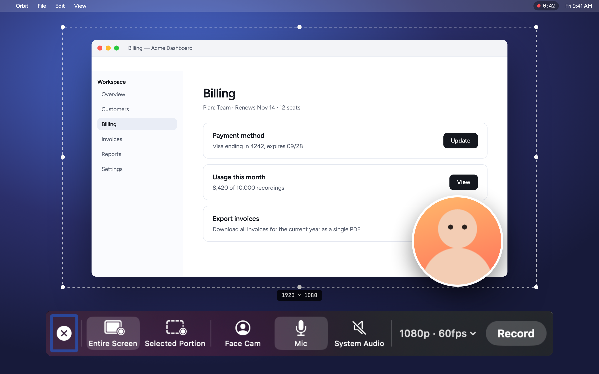

<p align="center">
  
</p>

<h1 align="center">Orbit</h1>

<p align="center">
  Screen recording for Mac, Windows, and Linux. Your face in a circle you can move, even after you stop.
</p>

<p align="center">
  <a href="https://github.com/calebynhan/orbit/releases/latest"></a>
  <a href="https://github.com/calebynhan/orbit/actions/workflows/ci.yml"></a>
  
  
  
  <a href="LICENSE"></a>
</p>

<p align="center">
  <a href="https://github.com/calebynhan/orbit/releases/latest">Download</a> ·
  <a href="https://calebynhan.github.io/orbit/">Website</a> ·
  <a href="https://github.com/calebynhan/orbit/issues">Issues</a>
</p>

## Features

- **⇧⌘5** on Mac, **Ctrl+Shift+5** on Windows and Linux opens the bar. Pick any shortcut you like.
- **Face cam** in a draggable circle. Move, resize, mirror, or re-record it after recording.
- **Entire screen or an area.** 16:9 lock snaps to an exact 1920 × 1080.
- **Local.** No account, no upload. Recordings go to your Movies / Videos folder, in `Orbit`.
- **Free and open source.**

## Install

### Mac

1. [Download the DMG](https://github.com/calebynhan/orbit/releases/latest) and drag Orbit to Applications.
2. First open: System Settings → Privacy & Security → **Open Anyway**. (Beta isn't notarized yet.)
3. Orbit lives in the menu bar. Follow the welcome guide.

macOS 15 or later. Apple Silicon and Intel.

### Windows

1. [Download `Orbit-<version>-win-x64.exe`](https://github.com/calebynhan/orbit/releases/latest) (or `arm64`) and run it.
2. SmartScreen may warn because the beta isn't signed: **More info → Run anyway**.
3. Orbit lives in the notification area (the tray). Follow the welcome guide.

Windows 10 version 2004 or later, so Orbit's own windows stay out of your recordings.

### Linux

[Download the AppImage or `.deb`](https://github.com/calebynhan/orbit/releases/latest) for x64 or arm64.

```bash
chmod +x Orbit-*.AppImage && ./Orbit-*.AppImage
```

```bash
sudo apt install ./Orbit-*.deb
```

Works on X11 and Wayland (through PipeWire and the desktop portal, which asks which screen to share each time). A few things work differently from Mac and Windows:

- Linux can't hide a window from a screen capture, so the live face cam and stop button show up in the screen video. Orbit still records the camera separately and overlays it at export, so restyling works; to also move the face cam freely afterwards, record a **Selected Portion** and keep the bubble outside it.
- System audio isn't captured yet. Your microphone is.
- If your desktop blocks global shortcuts (some Wayland desktops do), add a system shortcut that runs `orbit --toggle`.

## Build

Mac:

```bash
swift test
scripts/build-dmg.sh   # → build/Orbit-<version>.dmg
```

Xcode 16+. No dependencies.

Windows and Linux (from `desktop/`):

```bash
npm ci
npm test
npm start              # run from source
npm run dist:win       # → dist/Orbit-<version>-win-<arch>.exe
npm run dist:linux     # → dist/Orbit-<version>-linux-<arch>.AppImage and .deb
```

Node 22+. Electron, plus [Mediabunny](https://mediabunny.dev) for MP4 encoding.

## How it works

Screen and camera are recorded as separate files, with Orbit's own windows excluded from capture where the OS allows it. The bubble's path is sampled while you record. The editor composites them at export, so nothing is burned in.

```
Sources/OrbitCore     timeline, geometry, project file   (pure Swift, unit tested)
Sources/Orbit/Capture ScreenCaptureKit + AVFoundation
Sources/Orbit/UI      capture bar, bubble, welcome guide
Sources/Orbit/Editor  preview, Core Image compositor, export

desktop/src/core      the same logic in JavaScript       (unit tested against the Swift tests)
desktop/src/main      Electron main process: tray, shortcut, windows, recording flow
desktop/src/renderer  capture bar, bubble, area overlay, recorder, editor, export
```

Both apps read and write the same `project.json`. A recording made on Windows opens in the Mac app, and the other way around, as long as the computer can decode the video: Mac recordings use HEVC, which Windows plays with its HEVC support and most Linux systems don't, and Linux recordings use Opus audio, which the Mac app can't read.

## Contributing

Issues and pull requests welcome. See [CONTRIBUTING.md](CONTRIBUTING.md).

## License

[AGPL-3.0](LICENSE)
