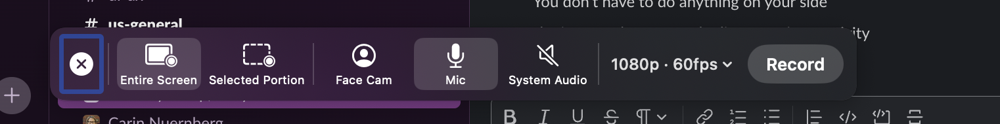
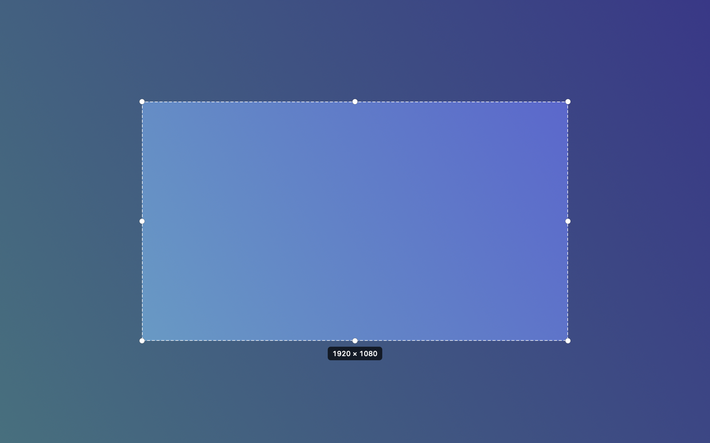

<p align="center">
  
</p>

<h1 align="center">Orbit</h1>

<p align="center">
  Screen recording for Mac. Your face in a circle you can move, even after you stop.
</p>

<p align="center">
  <a href="https://github.com/calebynhan/orbit/releases/latest"></a>
  <a href="https://github.com/calebynhan/orbit/actions/workflows/ci.yml"></a>
  
  <a href="LICENSE"></a>
</p>

<p align="center">
  <a href="https://github.com/calebynhan/orbit/releases/latest">Download</a> ·
  <a href="https://calebynhan.github.io/orbit/">Website</a> ·
  <a href="https://github.com/calebynhan/orbit/issues">Issues</a>
</p>

<br>

<p align="center">
  
</p>

## Features

- **⇧⌘5** opens the bar. Pick any shortcut you like.
- **Face cam** in a draggable circle. Move, resize, mirror, or re-record it after recording.
- **Entire screen or an area.** 16:9 lock snaps to an exact 1920 × 1080.
- **Local.** No account, no upload. Recordings go to `~/Movies/Orbit`.
- **Free and open source.**

## Install

1. [Download the DMG](https://github.com/calebynhan/orbit/releases/latest) and drag Orbit to Applications.
2. First open: System Settings → Privacy & Security → **Open Anyway**. (Beta isn't notarized yet.)
3. Orbit lives in the menu bar. Follow the welcome guide.

macOS 15 or later. Apple Silicon and Intel.

## Build

```bash
swift test
scripts/build-dmg.sh   # → build/Orbit-<version>.dmg
```

Xcode 16+. No dependencies.

## How it works

Screen and camera are recorded as separate files, with Orbit's own windows excluded from capture. The bubble's path is sampled while you record. The editor composites them at export, so nothing is burned in.

```
Sources/OrbitCore     timeline, geometry, project file   (pure Swift, unit tested)
Sources/Orbit/Capture ScreenCaptureKit + AVFoundation
Sources/Orbit/UI      capture bar, bubble, welcome guide
Sources/Orbit/Editor  preview, Core Image compositor, export
```

## Contributing

Issues and pull requests welcome. See [CONTRIBUTING.md](CONTRIBUTING.md).

## License

[AGPL-3.0](LICENSE)
